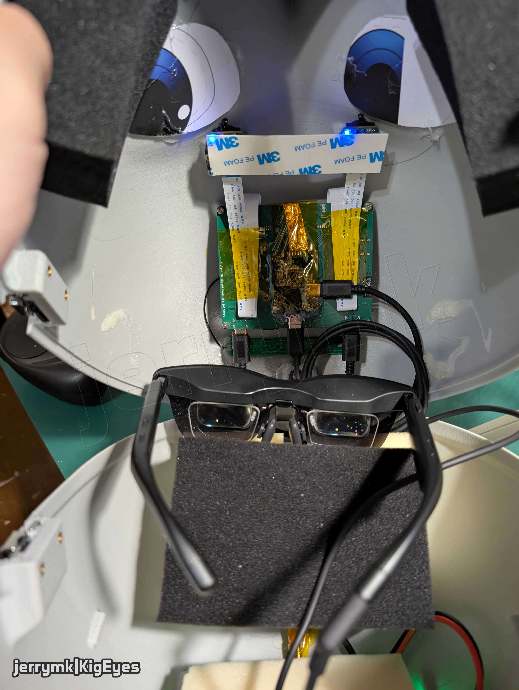

# Project KigEyes

Video passthrough and electronic eye for Kigurumi masks

## Project structure

| Directory | Description | Source status |
| --- | --- | --- |
| [companion](companion/) | Android app for connection setup, screen sharing, wearer viewing and phone-camera capture | Published |
| [docs](docs/) | Project documentation and illustrations | Selected files published |
| [drivers](drivers/) | Linux hardware drivers and device services | Partially published |
| `drivers/bluetooth` | Bluetooth compatibility fixes for controller input and haptics | Not published |
| `drivers/ec` | Linux link to the embedded controller: telemetry, commands and shutdown coordination | Not published |
| `drivers/glasses` | AR-glasses display control, IMU readings and orientation processing | Not published |
| [drivers/imx675](drivers/imx675/) | Linux sensor driver and device-tree support for KigEyes IMX675 modules | Core driver published |
| `drivers/imx675/libcamera` | IMX675 camera-stack integration and image-processing tuning | Not published |
| `drivers/imx678` | Experimental driver and bring-up tools for the IMX678 camera module | Not published |
| `firmware` | Microcontroller firmware for the custom boards | Not published |
| `firmware/camera-module` | Camera-module power sequencing, sensor management and synchronization controls | Publishing soon |
| `firmware/mainboard` | Mainboard controller, host communication and board diagnostics | Not published |
| `firmware/power-io-board` | Battery charging, power delivery, protection and power-state control | Not published |
| [integrations](integrations/) | Optional phone-mirroring and media integrations | Phone worker published |
| `integrations/jellyfin` | Jellyfin casting, playback and remote controls | Private |
| [integrations/scrcpy](integrations/scrcpy/) | Pi-side phone receiver, installation tools and Visor integration | Private |
| [integrations/scrcpy/worker](integrations/scrcpy/worker/) | Modified Android scrcpy worker with direct TLS, reconnection and panel controls | Published |
| `integrations/spotify` | Spotify Connect receiver integration and playback controls | Private |
| [licenses](licenses/) | License texts for published software and hardware | Published |
| [PCB](PCB/) | Schematics, PCB layouts and manufacturing files | Selected designs published |
| `PCB/eye-tracker-mainboard` | Eye-tracking controller board development | Publishing soon |
| `PCB/IMX675-camera-module` | Custom IMX675 sensor module and its management circuitry | Publishing soon |
| `PCB/IMX678-renheng-adaptor` | Adapter and management board for the Renheng IMX678 module | Publishing soon |
| `PCB/kigeyes-mainboard` | Compute Module 5 carrier with camera, display and peripheral connections | v1 work in progress |
| [PCB/kigeyes-power-io-board](PCB/kigeyes-power-io-board/) | Battery, charging, power conversion and peripheral power board | v2 work in progress |
| [PCB/OVM6211-bga2lga](PCB/OVM6211-bga2lga/) | OVM6211 sensor package adapter board | Published |
| [PCB/OVM6211-fpc](PCB/OVM6211-fpc/) | Flexible OVM6211 camera board for eye-tracking hardware | Published |
| `STL` | Printable mask parts, mounts and mechanical prototypes | Not published yet |
| `visor` | On-mask passthrough, display composition, HUD and system control | Private |

## Open source status

This project is not fully open source for now.

- **All** general-purpose designs and reusable components that may benefit the open-source community will be released in full, such as camera sensor drivers, breakout boards, and eye tracking algorithms.
- **Most** schematics will be released in full
- **Some** PCB design files and Gerbers remain closed until obsolete
- **Most** firmware and source code will be released in full
- **Some** mechanical design files will be released in full

## KiCad library

KiCad library available at [jrymk/jerrymk_kicad_lib](https://github.com/jrymk/jerrymk_kicad_lib).
